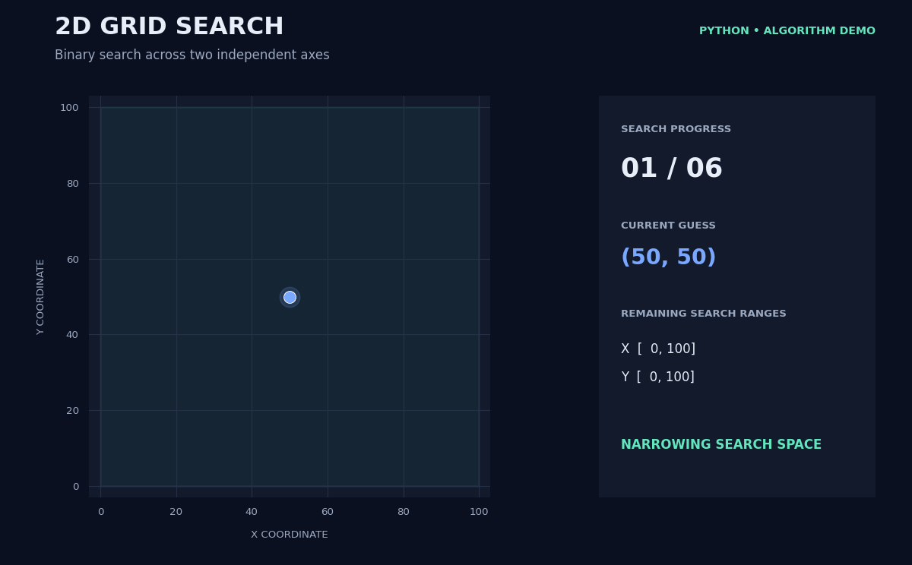

# 2D Grid Guessing Game

A Python project that extends the classic Number Guessing Game into two dimensions. Instead of guessing a single secret number, the algorithm searches for a secret coordinate `(x, y)` on a grid using binary search.

This is my **first working prototype** of the project. It is an experiment in applying binary search to a two-dimensional search space while practicing Python fundamentals.

## How It Works

1. **Generate a secret coordinate.** The program randomly selects an X-coordinate and a Y-coordinate within the grid.
2. **Initialize the search ranges.** Both axes start with a range from `0` to `n`.
3. **Guess the midpoint.** The algorithm calculates the midpoint of each remaining range to produce a coordinate guess.
4. **Narrow the search.** Each guessed coordinate is compared with its corresponding secret coordinate. If the guess is too high or too low, the relevant range is reduced.
5. **Repeat until found.** The process continues until both coordinates match the secret coordinate.
6. **Display the result.** The program returns the correct coordinate and the number of guesses taken.

### Visualization



## Example Output

```text
Secret coordinate: (73, 28)
Found secret coordinate: [73, 28] with 7 steps
```

*The example is illustrative; the actual secret coordinate and number of steps vary between runs.*

## Technologies

* Python
* `random` module for generating secret coordinates
* Binary search logic using integer division (`//`)

## Current Features

* Randomly generated secret coordinates
* Configurable grid dimensions
* Simultaneous binary search along the X and Y axes
* Automatic adjustment of search ranges
* Returns the discovered coordinate and number of steps

## What I Learned

* Applying binary search beyond a single number
* Managing independent search ranges for two dimensions
* Using loops and conditional statements to narrow a search space
* Returning multiple results from a Python function
* Breaking a problem into smaller, independent operations

## Future Improvements

This is an early prototype, and I plan to expand it with features such as:

* A visual representation of the grid and each guess
* An animation showing how the search ranges shrink
* User-configurable grid sizes and search settings
* Performance comparisons with other search algorithms
* More detailed statistics and step-by-step debugging information

## Project Status

**Working prototype, under development.**

This project is part of my journey in learning Python, algorithms, and problem-solving through personal projects.
